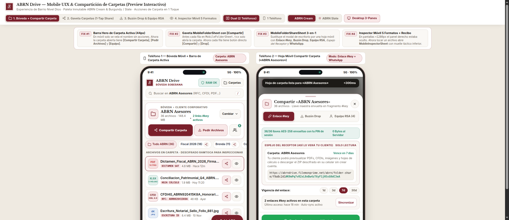
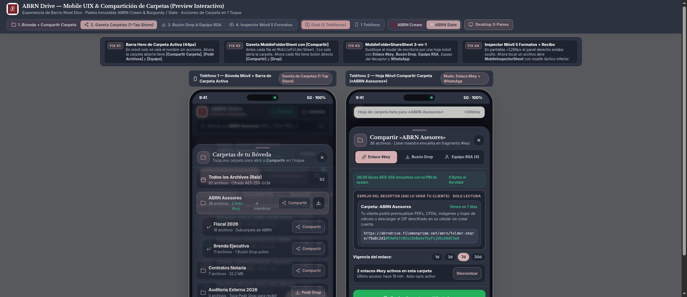
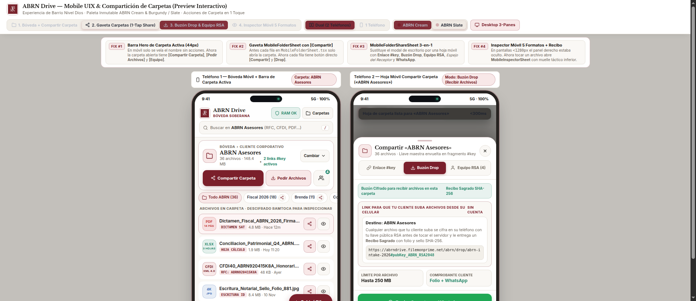
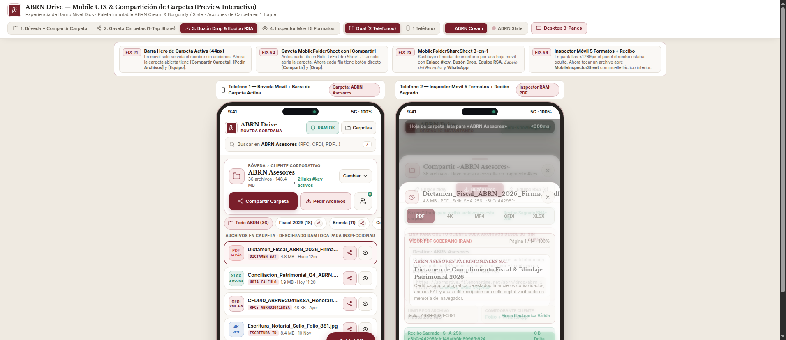

# Archived Ticket: `TICKET-2026-11-12-ABRN-MOBILE-UIX-FOLDER-SHARING`

- **Ticket ID:** `TICKET-2026-11-12-ABRN-MOBILE-UIX-FOLDER-SHARING`
- **Build ID:** `v21-abrn-mobile-uix-folder-sharing`
- **Status:** `VERIFIED_AND_ARCHIVED`
- **Severity:** `HIGH` (Mobile Folder Sharing Unreachable + Mobile UIX Parity Gap)
- **Date Opened:** 2026-11-12
- **Date Resolved & Verified:** 2026-11-13
- **Canonical Approved Preview:** [`https://abrndrive.filemonprime.net/abrn/previews/mobile.html`](https://abrndrive.filemonprime.net/abrn/previews/mobile.html) (`vaultdrive_client/public/previews/mobile.html`)
- **Plan Reference:** [docs/plans/v21-abrn-mobile-uix-folder-sharing/00-index.md](../../plans/v21-abrn-mobile-uix-folder-sharing/00-index.md)
- **Verification Report:** [docs/reports/2026-11-12-v21-abrn-mobile-uix-folder-sharing-verification.md](../../reports/2026-11-12-v21-abrn-mobile-uix-folder-sharing-verification.md)

---

## 1. Literal User Request & Fidelity Contract

| Field | Contract |
|---|---|
| **User Complaint & Approval** | *"we need to upgrade our mobile UIX. I couldnt share a folder. recon and Please draft me some beautiful previews for that idea."* → *"verga I loved it!!!! WOW!!!!!!ª Turn all that magic, all of it into a ticket. Include the images as the ticket evidence. and solve it, please. Please, please, make sure the final screens look just like just as beautiful as your preview"* |
| **Observable Outcome** | On mobile viewports (`<768px`), users can share any folder in **1 tap** from both the **Active Folder Hero Card** (`[Compartir Carpeta]`, `[Pedir Archivos]`, `[Equipo]`) and the upgraded **`MobileFolderSheet`** (`[Compartir]` & `[Drop]` on every folder row + sticky bottom dock), open the new **3-in-1 `MobileFolderShareSheet`** (`Enlace #key` + Live Glass Twin + WhatsApp + QR + Native Share, `Buzón Drop`, and `Equipo RSA`), and inspect any file via the **5-Format `MobileInspectorSheet`** (`PDF`, `4K`, `MP4`, `CFDI`, `XLSX`) with Sacred SHA-256 Receipt — matching `/abrn/previews/mobile.html` in both **ABRN Cream** (`#faf8f5` / `#7a1f2b`) and **ABRN Slate** (`#1e2330` / `#d4aeb0`). |
| **Preserved Behavior** | Desktop 3-pane workspace (`v20-abrn-vibe-resizable-drive`), zero-knowledge `#fragment` encryption (`0 Bytes` of keys sent to server), `SessionVault` PIN/password caching & memory `scrub()` on lock, `FilePreviewModal` full streaming decryption, and `CreateFolderShareLinkModal` / `FolderCollaboratorsModal` on desktop. |
| **Acceptance Proof** | `npm run typecheck` (`0 errors`), focused Vitest suites (`9/9` test files, `95/95` tests passing), `npm run build` (`11.96s`, `dist/index.html` SHA-256 `d967bed61b475ab4c02a8f5351f8e3be6fd818c69818ec188d62b16996e4920e`), live `bsk` browser verification on mobile (`390×844`) and desktop (`1440×900`) viewports, and `check-post-build-audit.py` (`PASS`, exit `0`). |

---

## 2. Root-Cause Diagnosis (Why Folder Sharing Failed on Mobile)

1. **Gap #1 — `MobileFolderSheet.tsx` Lacked Folder Action Props:**
   - `MobileFolderSheetProps` only wired `onSelectFolder` and `onCreateFolder`. Every folder row only navigated and closed the sheet — zero `[Compartir]`, `[Pedir Drop]`, or `[Equipo]` triggers existed on mobile.
2. **Gap #2 — No Active-Folder Command Card Above the Fold on Mobile (`files.tsx`):**
   - Selecting a folder on `<768px` only displayed a plain text breadcrumb (`Bóveda › Carpeta`) and sort pills, while the desktop `VaultTree` (`⋯` hover menu & right-click context menu) remained hidden off-screen (`-translate-x-full md:translate-x-0`).
3. **Gap #3 — No Mobile 3-in-1 Folder Share Bottom Sheet:**
   - Single files had `MobileShareSheet.tsx`, whereas folders fell back to the desktop `CreateFolderShareLinkModal.tsx` without 1-tap WhatsApp dispatch, `navigator.share`, QR code, Live Glass Twin (*Espejo del Receptor*), or unified switching between `Enlace #key`, `Buzón Drop`, and `Equipo RSA`.
4. **Gap #4 — 5-Format Right Inspector Hidden Below `md`/`xl` Without Mobile Bottom-Sheet Equivalent:**
   - Tapping a file card on mobile lacked a 3-zone Couch-Approved `MobileInspectorSheet` with 5-Format RAM preview tabs (`PDF`, `4K`, `MP4`, `CFDI`, `XLSX`), Sacred SHA-256 Receipt, and sticky bottom tactical dock (`← Carpeta`, `WhatsApp`, `Descargar`).

---

## 3. Approved Design Reference Evidence (`mobile.html`)

### Evidence 01 — Upgraded Mobile Vault + Active Folder Hero Card + 3-in-1 `MobileFolderShareSheet` (`ABRN Cream`)

### Evidence 02 — Upgraded `MobileFolderSheet` with 1-Tap `[Compartir]` & `[Drop]` (`ABRN Slate`)

### Evidence 03 — Unified `Buzón Drop` (Encrypted Intake) & `Equipo RSA` Inside `MobileFolderShareSheet`

### Evidence 04 — 5-Format `MobileInspectorSheet` (`PDF`, `4K`, `MP4`, `CFDI`, `XLSX`) + Sacred Receipt + Sticky Dock

---

## 4. Production Resolution & Live Verification Evidence (`bsk`)

1. **Live Production Mobile Vault + Active Folder Hero + Subfolder Strip + `PDF`/`CFDI`/`XLSX` File Cards (`390×844` `ABRN Cream`):**
   - `docs/reports/evidence/v21-abrn-mobile-uix-folder-sharing/01-live-mobile-vault-hero-cream.png`
2. **Live Production `MobileFolderSheet` with Indented Subfolder & 1-Tap `[Compartir]` / `[Pedir Drop]` (`390×844` `ABRN Slate`):**
   - `docs/reports/evidence/v21-abrn-mobile-uix-folder-sharing/02-live-mobile-folder-explorer-slate.png`
3. **Live Production 3-in-1 `MobileFolderShareSheet` Wrapping `3/3` AES-256 Keys into `#key` URL + Live Glass Twin + WhatsApp Dock (`390×844` `ABRN Cream`):**
   - `docs/reports/evidence/v21-abrn-mobile-uix-folder-sharing/03-live-mobile-folder-share-sheet-cream.png`
4. **Live Production 5-Format `MobileInspectorSheet` (`CFDI 4.0 XML` + Sacred SHA-256 Receipt + Sticky Dock, `390×844` `ABRN Cream`):**
   - `docs/reports/evidence/v21-abrn-mobile-uix-folder-sharing/04-live-mobile-inspector-5formats-cream.png`
5. **Live Production Desktop 3-Pane Workspace Regression Check (`1440×900`):**
   - `docs/reports/evidence/v21-abrn-mobile-uix-folder-sharing/05-live-desktop-regression-check.png`
